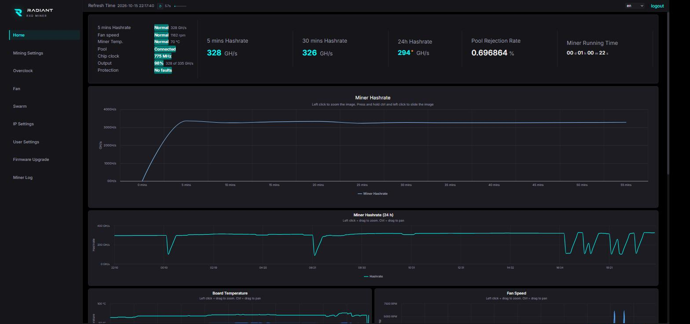
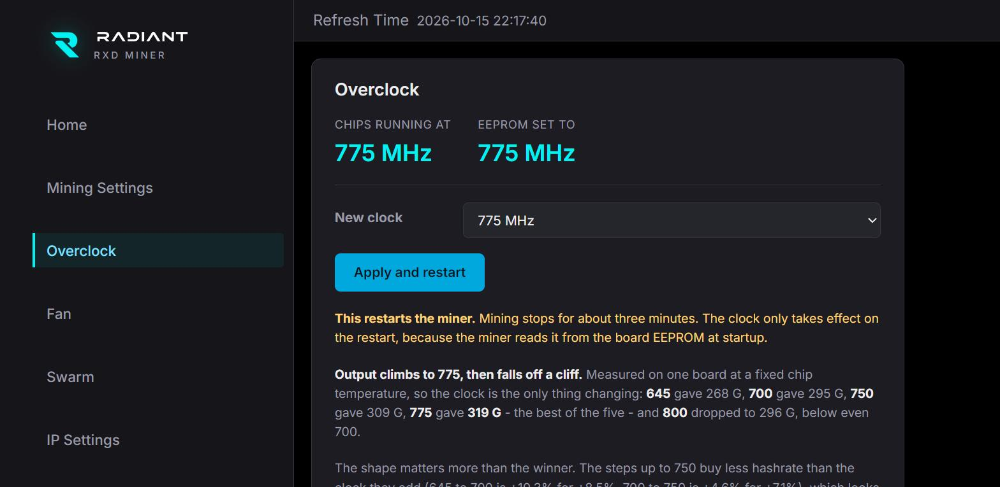

# Radiant RXD dashboard for the IceRiver RX0

A replacement web UI, a JSON API, a real fan controller and an opt-in
overclock page for the IceRiver RX0 ASIC miner, installed over SSH.



It does not modify the miner's firmware package. Everything the dashboard
needs is a text change to plain files in the web root the miner unpacks at
boot, so the stock `*_bg.bgz` is left exactly as it shipped and a small boot
script reapplies the changes each time. Nothing to back up, nothing to
restore, and a firmware update cannot leave you half-patched: the new package
unpacks clean and gets patched again.

---

## What you need first: a shell on the miner

**This repository installs over SSH, and a stock RX0 will not let you in.**
It runs dropbear on port 54188 with root logins disabled and no other
account - so it listens for SSH and refuses everybody. That single missing
account is the only thing in the way.

Two ways to get one, neither of them in this repository:

* **A serial console (UART).** Header on the control board, 115200 8N1. This
  is the route that depends on nothing and nobody, and it is the one to use if
  you want to understand the machine rather than trust a stranger's firmware.
  You get a root shell, create a user, and you are done.
* **Install pbfarmer's firmware first.** It ships a boot script that creates
  an account on every boot, which is how most people end up with a shell on
  one of these. It is third-party firmware that also changes chip voltage;
  read what it does before running it. It is not affiliated with this project.

There is a third route - an update package uploaded through the miner's own
Firmware Upgrade page - and it is deliberately **not** here. Building one
means re-encrypting IceRiver's container, which needs their passphrase. That
passphrase is not published in this repository and will not be.

Once you can log in:

```
python install_rxd.py --host 10.0.0.42 --ask-password --enable-oc
```

Reboot, or don't - it applies to the running web root immediately.

```
python install_rxd.py --host 10.0.0.42 --uninstall
```

puts it back. Requires `paramiko` on your machine, and nothing on the miner
beyond the Python 2.7 it already ships.

---

## What you get

**A dashboard** that replaces the stock home page: hashrate and temperature
history, per-chip temperature/voltage/clock charts, pool state and share
counts, and a protection panel.

**A JSON API** on port 4112 (and 4113 over TLS if you install a certificate),
served by a small bridge running on the miner:

| Endpoint | What it gives |
|---|---|
| `GET /summary` | one compact row: hashrate, chips, clock, temps, fan, shares, uptime |
| `GET /performance` | actual against expected hashrate, with the core count it used |
| `GET /chipinfo` | per-chip temperature, voltage and PLL, plus protection state |
| `GET /history` | hashrate, board temperature and fan, replayed from the miner's logs |
| `GET /chiphistory` | per-chip history, sampled by the bridge itself |
| `GET /fan`, `POST /setfan` | fan mode and speed |
| `GET /clock`, `POST /setclock` | chip clock (only when overclocking is enabled) |
| `GET /swarm` | every miner you have added, fetched in parallel |

**A fan controller** with two modes. A fixed ratio, or hold a target chip
temperature and let the ratio move - because a fixed ratio is only correct for
one ambient temperature, and the stock curve is not configurable at all.

**A swarm page** that shows every RX0 you have added, from any one of their
dashboards, with a total across all of them.

It can also **scan the subnet**, which is more useful than it sounds: unbox a
miner, plug it in, press Scan, and it is listed - no hunting through the
router's DHCP table for whatever address the new unit was given. Miners still on
stock firmware are found and read too, with hashrate, temperature, fans, shares
and uptime taken from their own unauthenticated web API. So a new RX0 shows up
complete before you have touched its firmware, which is when you most want to
look at it: that is when you find out whether it arrived healthy.

Chip count, clock and chip temperature stay blank for a stock miner rather than
being filled in. The stock payload does report them and they are wrong on an
RX0 - 18 chips against the 12 fitted, 875 MHz against 775 - so the bridge
discards them. A blank reads as "not reported", which is true; a number would be
believed.

**An overclock page**, off unless you pass `--enable-oc`.

---

## Overclocking: higher is not automatically faster



The chip clock lives in the hash board's EEPROM, which the miner reads at
startup and ramps the chips to. Changing it means writing that EEPROM and
rebooting - there is no way to apply it to a running miner, and the page says
so rather than pretending otherwise.

Measured on one board, each figure a multi-hour average at a settled chip
temperature:

| Clock | Hashrate | Per MHz | % of theoretical |
|------:|---------:|--------:|-----------------:|
| 645 MHz | 267.6 GH/s | 0.415 | 96.0% |
| 700 MHz | 295.2 GH/s | 0.422 | **97.6%** |
| 750 MHz | 308.8 GH/s | 0.412 | 95.3% |
| **775 MHz** | **324.4 GH/s** | **0.419** | **96.9%** |
| 790 MHz | 306.5 GH/s | 0.388 | 89.8% |
| 800 MHz | 295.8 GH/s | 0.370 | 85.6% |

**Output peaked at 775, and both settings above it came in below 700.**
Per-MHz yield does not fall from 750 to 775 - it rises - and then gives way:
750 to 775 buys 5.1% for 3.3% more clock, while 775 to 790 *loses* 5.5% for
1.9% more and 775 to 800 loses 8.8%. So it is a plateau to 775 followed by a
fall that begins somewhere in the 15 MHz above it, gradual rather than a step:
790 already sits two thirds of the way down to 800. Chips were no hotter at 775
than at 750 (63.84 average against 63.97 over hundreds of samples) and no
hotter again at 790, so this is not thermal throttling; the chips still
calibrate and run, they just find fewer nonces per cycle.

That also closes the band. Interpolating the measured slope puts 780 near 318
and 785 near 312, both below 775, and even if the onset sat just above 780 the
most it could buy is about 2 GH/s - less than the drift one clock shows across
a single long run.

So the honest way to pick a value is to run one for **hours** and compare the
average, not to pick the biggest number that boots. A method that fitted a
curve to four points and predicted the peak was tried here and was wrong by
19 GH/s, because it extrapolated across that discontinuity.

The exception is *rejecting* a clock, which is quick. Because the Output
percentage below scales its denominator with the clock, it is comparable across
settings in a way raw GH/s is not, and it reads live rather than averaged - 790
was screened out on four readings over two minutes at eleven minutes of uptime,
88.8-90.8% against 775's 96.8-98%. Confirming a *small* win still needs the
hours, because what you are chasing is smaller than the drift within one run.

A clock the board cannot run fails safe: the miner refuses to start rather
than hashing badly, and the next change brings it back. The page bounds the
value to 600-800 MHz in 5 MHz steps, verifies the write by reading the EEPROM
back, and logs every change with the address that asked for it.

**Voltage is not touched, by this or by anything here.** It is the setting
that can destroy a board rather than merely waste a boot.

### The Output figure

`actual / (live cores x MHz x 3.0)`, where 3.0 is hashes retired per core per
clock cycle. Everything in the denominator is measured rather than assumed.

Two traps that cost real debugging time, in case you are reading the same
numbers from somewhere else:

* The miner's core-state report always lists **36 chip slots - three boards'
  worth - and marks every core in all of them alive**, including the chips a
  one-board RX0 does not have. Counting them all gives 432 cores where the
  truth is 144, and an expectation three times too large.
* `actual` must be the **live** hashrate, not a trailing average. Pairing a
  30-minute average with a steady-state expectation makes a healthy miner read
  as 46% of capacity for the first half hour after a boot.

---

## How the install works

`install_rxd.py` copies five things to `/var/order`, which is jffs2 and
survives both reboots and firmware updates:

```
/var/order/rxd_bridge.py      the JSON API
/var/order/rxd_fanset.sh      the fan controller
/var/order/rxd_webpatch.py    applies the dashboard to an unpacked web root
/var/order/web/               the dashboard's own files
/var/order/conf/              fan settings, overclock flag
```

and three init scripts: `rxdbridge` (S97), `rxdfan` (S98) and `rxdweb` (S99).

`rxdweb` is the interesting one. `/var/volatile/tmp/bg` is tmpfs, rebuilt from
`/var/update/*_bg.bgz` on every boot, so a patch applied there does not
survive a restart - `rxdweb` reapplies it. It must run after `S99boot.sh`,
which is what unpacks the package, and `S99rxdweb` sorts after `S99boot.sh`
because `boot.sh` sorts before `rxdweb`. That ordering is necessary but not
sufficient: `boot.sh` returns before the unpack has finished, so the script
waits for `web/js/base.js` to actually appear, and the sort order only avoids
a guaranteed miss. Measured around 12 seconds on one miner.

Every patch is idempotent and checks a marker first, because it will routinely
run over a tree a previous boot already patched.

**What it changes:** appends a hook to `base.js`, fixes a stock bug in
`index.js` (`loading(1)` fires before the in-flight guard, so an overlapping
refresh leaves the loading bar stuck), recolours six stock stylesheets, and
copies in the dashboard script and theme.

**The one thing this route cannot do is HTTPS for the web UI.** That needs a
`ListenSecure` directive in `appweb.conf`, and appweb reads that once at
startup, so adding it after boot does nothing. The bridge still serves TLS on
4113 if you put a certificate in `/var/order/conf`.

---

## Notes from taking one apart

`docs/hardware-notes.md` has the board details. In brief: Zynq XC7Z010
CLG400, DDR3, microSD, IP101GA 10/100 PHY, a 4-phase buck, and twelve hash
chips. The control board is shared with the KS-series units.

The miner exposes a line-oriented JSON command port on 4111. The bridge only
ever issues getters, from a fixed allowlist - it cannot send a write command
even if something asks it to, because the fan and the clock are changed by
other means entirely.

Two sensors on the I2C bus at 0x48 and 0x49 are 12-bit, 0.0625 °C parts whose
low four bits the stock firmware throws away, so the PCB temperatures it shows
you are integers from something 16 times more precise. There is no power
monitor on the bus - nothing at 0x40-0x47 or 0x4a-0x4f, no PMBus - so any
wattage figure for one of these is inferred, not measured.

---

## Scope, and what is not here

This repository contains original work: the dashboard, the bridge, the fan
controller, the installer and the notes. It contains **no IceRiver code, no
decompiled listings, no firmware images and no container passphrase.** The
behaviour described above is described in prose and measurements, which is
what you need in order to interoperate with the machine you own.

Interoperability reverse engineering of this kind is explicitly contemplated
by 17 U.S.C. § 1201(f) in the United States and by Article 6 of the EU
Software Directive; your jurisdiction may differ.

Not affiliated with, endorsed by, or supported by IceRiver. **Running this
will void your warranty**, and overclocking an ASIC can destroy it. The
overclock page is off by default for that reason.

## Licence

MIT - see [LICENSE](LICENSE).
